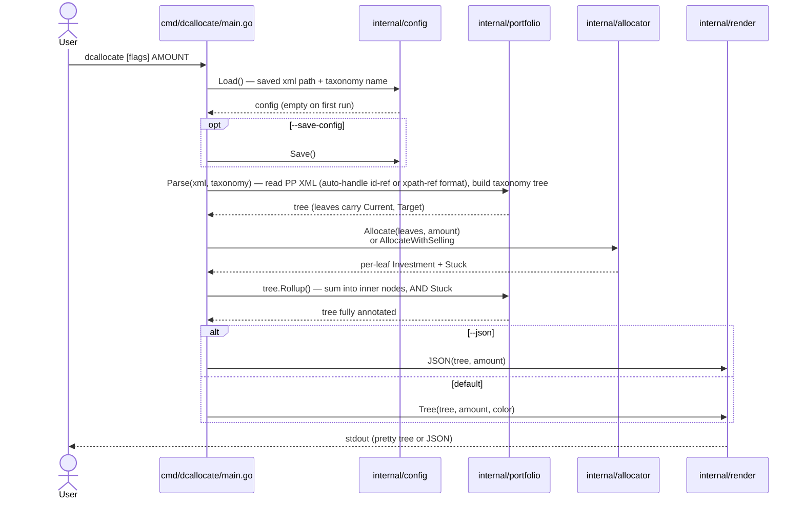

<p align="center">
  
</p>

---

[](https://github.com/Konilo/dcallocate/actions/workflows/ci.yml)
[](https://github.com/Konilo/dcallocate/releases/latest)
[](LICENSE)

- **DCA-friendly, low-cost rebalancing.** The default mode is water-filling: allocate new contributions to underweight assets first, no selling, minimizing fees and realized-gains tax. `--allow-selling` enables a full rebalance with selling. A built-in 5/25 rule signals when such a rebalance is actually needed.
- **Reads [Portfolio Performance](https://www.portfolio-performance.info/) XML** directly (read-only) and fills a gap PP's own allocation tool doesn't cover.
- Single static binary, **zero third-party dependencies**, no network access or subprocess.

---

Selling assets to keep a portfolio balanced causes additional costs (order fees, realized-gains tax). When contributions are large enough to absorb the drift between the assets' current values and their targets, selling to rebalance is not needed. Portfolio Performance has an allocation tool, but only for the rebalance-with-selling case. `dcallocate` covers both halves of a typical DCA investor workflow and the bridge between them:

1. **Recurring DCA contributions** (e.g., monthly): water-filling allocates the cash without sells.
2. **Knowing when a full rebalance with selling is necessary**: a built-in 5/25 rule flags whether the post-contribution portfolio is balanced enough. When it isn't, that's the signal to re-run with `--allow-selling`.
3. **Rebalancing with selling**: `--allow-selling` performs a full rebalance for the case where drift has outgrown what contributions can correct.

The mathematical complexity it handles for you: when one or more assets are already over their target weight, those assets receive nothing, and the contribution is distributed among the others which can, in turn, go over target, **recursively**. The technique `dcallocate` applies has a couple of names: **rebalancing by investing** (the descriptive English) and **water-filling** (the projection-onto-the-simplex math behind it).

<p align="center">
  
  <br>
  <em>Physical representation of water-filling.<br>Cf. the companion study to understand the case it represents.<br>Source: <a href="https://konilo.github.io/sandbox/sandbox/portfolio_contribution_complexities/portfolio_contribution_complexities.html#fig-demo-case-4">Konilo/sandbox, Portfolio Contribution Complexities, Figure 4</a>.</em>
</p>

## Install

Download the right binary from the [latest release](https://github.com/Konilo/dcallocate/releases) and put it on your `PATH`:

| OS                    | Binary                         | Where to put it                                                                          |
| --------------------- | ------------------------------ | ---------------------------------------------------------------------------------------- |
| Windows               | `dcallocate-windows-amd64.exe` | rename to `dcallocate.exe`, drop in `%USERPROFILE%\bin\` (and ensure that's on `PATH`)   |
| Linux (x86_64)        | `dcallocate-linux-amd64`       | `~/.local/bin/dcallocate`, `chmod +x` |
| Linux (arm64)         | `dcallocate-linux-arm64`       | ditto |
| macOS (Apple Silicon) | `dcallocate-darwin-arm64`      | ditto |
| macOS (Intel)         | `dcallocate-darwin-amd64`      | ditto |

## Usage

```sh
# First run: provide the path + taxonomy and persist them.
dcallocate --xml /path/to/portfolio.xml --taxonomy "Asset Classes" --save-config 1000

# Every subsequent run, just pass the contribution amount:
dcallocate 1000
```

Output is a tree showing every taxonomy node with (i) roll-up totals at inner nodes (so you see "wire X € to your broker" via the parent of the children that need the money) and (ii), for visibility, the underlying securities/accounts that make up each taxonomy leaf. (See the [Portfolio Performance taxonomies docs](https://help.portfolio-performance.info/en/reference/view/taxonomies/) for background.)

```
asset                        current     now %  target %     post %     5/25 band          invest
─────────────────────────────────────────────────────────────────────────────────────────────────
Asset Classes           40000.00 EUR  100.00 %  100.00 %  100.00 %                   +1000.00 EUR
├── Stocks              30000.00 EUR   75.00 %   70.00 %   73.17 %    65.00-75.00               —
│   └── Index ETF       30000.00 EUR
├── Bonds                8000.00 EUR   20.00 %   25.00 %   21.95 %    20.00-30.00    +1000.00 EUR
│   └── Bond ETF         8000.00 EUR
└── Cash                 2000.00 EUR    5.00 %    5.00 %    4.88 %      3.75-6.25               —
    └── Money Market     2000.00 EUR
─────────────────────────────────────────────────────────────────────────────────────────────────
Total contributed: +1000.00 EUR  (post-contribution portfolio: 41000.00 EUR)
```

The `—` in the `invest` column marks **stuck** taxonomy nodes that receive nothing because they are already at or over their target. Note that, pre-contribution, `Cash` is exactly at its target percentage (5 % of 40000 € = 2000 €) yet still gets stuck. Once `Stocks` (the most-overweight leaf) is excluded, water-filling has to bring `Bonds` and `Cash` to a combined post-contribution value of 11000 € (their current 10000 € plus the 1000 € contribution), split proportionally to their renormalised target weights (25/30 for `Bonds`, 5/30 for `Cash`). Cash's renormalised target value is therefore $11000 \times 5/30 \approx 1833\text{ }€$, *below* its current 2000 €: reaching it would require selling about 167 € of `Cash`, which the no-selling rule forbids. So `Cash` is stuck too, and the full 1000 € ends up in `Bonds`. (Cf. the [Water-filling mode](#water-filling-mode) section for the precise statement of the algorithm.)

### The 5/25 rule check

The `post %` and `5/25 band` columns tell you whether water-filling alone is keeping the portfolio close enough to its targets. The band for each taxonomy node is the tighter of:

- **absolute** ±5 percentage points around the target, and
- **relative** ±25 % of the target (binding for targets below 20 %).

This is Larry Swedroe's **5/25 rule**, cf. the [Bogleheads wiki](https://www.bogleheads.org/wiki/Rebalancing#cite_note-5/25-1).

When the post-contribution share of any taxonomy node falls outside its band, a warning is printed under the table (and the breaching rows are coloured red on a colour-capable terminal). Here `Stocks` have drifted down to 56.10 % (well below the 65-75 % band) and `Bonds` up to 39.02 % (above the 20-30 % band). The contribution can only buy more `Stocks`, but not enough to absorb the drift:

```
asset                        current     now %  target %     post %     5/25 band          invest
─────────────────────────────────────────────────────────────────────────────────────────────────
Asset Classes           40000.00 EUR  100.00 %  100.00 %  100.00 %                   +1000.00 EUR
├── Stocks              22000.00 EUR   55.00 %   70.00 %   56.10 %    65.00-75.00    +1000.00 EUR
│   └── Index ETF       22000.00 EUR
├── Bonds               16000.00 EUR   40.00 %   25.00 %   39.02 %    20.00-30.00               —
│   └── Bond ETF        16000.00 EUR
└── Cash                 2000.00 EUR    5.00 %    5.00 %    4.88 %      3.75-6.25               —
    └── Money Market     2000.00 EUR
─────────────────────────────────────────────────────────────────────────────────────────────────
! Portfolio is unbalanced, 2 nodes outside 5/25 band: Stocks, Bonds
Total contributed: +1000.00 EUR  (post-contribution portfolio: 41000.00 EUR)
```

A breach means your monthly contribution is no longer big enough to absorb the drift. That's the signal to switch from water-filling to a closed-form rebalance: re-run with [`--allow-selling`](#allowing-selling).

Pass `dcallocate --amount 0` (or just `dcallocate 0`) to see the band check against the current portfolio without simulating any contribution.

Pass `--no-band-check` to hide the two extra columns and the warning (e.g., for a narrower terminal).

### Allowing selling

Pass `--allow-selling` for a **full rebalance** that lands every taxonomy node exactly on its target:

```sh
dcallocate --allow-selling 1000
```

```
asset                        current     now %  target %     post %     5/25 band          invest
─────────────────────────────────────────────────────────────────────────────────────────────────
Asset Classes           40000.00 EUR  100.00 %  100.00 %  100.00 %                   +1000.00 EUR
├── Stocks              30000.00 EUR   75.00 %   70.00 %   70.00 %    65.00-75.00    -1300.00 EUR
│   └── Index ETF       30000.00 EUR
├── Bonds                8000.00 EUR   20.00 %   25.00 %   25.00 %    20.00-30.00    +2250.00 EUR
│   └── Bond ETF         8000.00 EUR
└── Cash                 2000.00 EUR    5.00 %    5.00 %    5.00 %      3.75-6.25      +50.00 EUR
    └── Money Market     2000.00 EUR
─────────────────────────────────────────────────────────────────────────────────────────────────
Total contributed: +1000.00 EUR  (post-contribution portfolio: 41000.00 EUR)
```

Per-asset `invest` values can be negative ("sell that much") and the sum of `invest` values always equals the contribution. Pass `--allow-selling 0` for a pure rebalance with no contribution to the portfolio.

### Flags

| Flag               | Meaning                                                                                                 |
| ------------------ | ------------------------------------------------------------------------------------------------------- |
| `--xml PATH`       | path to your Portfolio Performance XML                                                                   |
| `--taxonomy NAME`  | which taxonomy holds the targets (e.g., `"Asset Classes"`)                                              |
| `--amount EUR`     | amount to contribute, in the portfolio's base currency (or pass it positionally: `dcallocate 1000`)     |
| `--save-config`    | persist `--xml` and `--taxonomy` for next time                                                          |
| `--allow-selling`  | permit negative per-asset `invest` values (sells) so weights land exactly on target                     |
| `--no-band-check`  | hide the post-contribution 5/25 rule check (extra `post %` and `5/25 band` columns + unbalance warning) |
| `--color MODE`     | `auto` (default), `always`, or `never`                                                                  |
| `--json`           | machine-readable JSON output                                                                            |

### Configuration

The persisted config (XML path + taxonomy name) lives at:

- Windows: `%AppData%\dcallocate\config.json`
- Linux: `${XDG_CONFIG_HOME:-~/.config}/dcallocate/config.json`
- macOS: `~/Library/Application Support/dcallocate/config.json`

## How it works



## The math

Inputs:
- $c_i$ = current value of taxonomy leaf $i$ (in base currency)
- $t_i$ = target weight of leaf $i$ (fractions sum to 1)
- $C$ = contribution amount, $C \ge 0$

### Water-filling mode

Let $V = \sum_i c_i + C$ be the post-contribution portfolio total. At each pass, for every leaf $i$ not yet stuck, compute $x_i$, the amount it should receive from the contribution:

$$x_i = \frac{t_i}{\sum_{j \in \text{non-stuck}} t_j} \cdot \left(V - \sum_{k \in \text{stuck}} c_k\right) - c_i$$

If any $x_i < 0$, mark those leaves as stuck (i.e., force $x_i := 0$) and repeat. Considering $N$ leaves, the algorithm terminates in at most $N$ passes: each non-terminal pass marks at least one leaf as stuck.

### `--allow-selling` mode (closed-form)

$$x_i = t_i \cdot \left(\sum_j c_j + C\right) - c_i \qquad \forall\, i$$

Some $x_i$ values may be negative, but $\sum_i x_i = C$. Every leaf lands exactly on its target weight in one pass.

For the full derivation, correctness proof, and an R reference implementation, see the [Portfolio Contribution Complexities](https://konilo.github.io/sandbox/sandbox/portfolio_contribution_complexities/portfolio_contribution_complexities.html) companion study.

## Portfolio Performance file format

`dcallocate` was tested against Portfolio Performance **v0.83.2** (the latest stable release at time of writing). Earlier versions probably work too as the relevant XML schema (XStream-serialised) has been stable for years.

The parser maps PP's XML elements as follows:

| PP XML element                                       | Used for                                                                              |
| ---------------------------------------------------- | ------------------------------------------------------------------------------------- |
| `<baseCurrency>`                                     | Portfolio's reporting currency. Required.                                             |
| `<securities>` → `<security>`                        | Each holding's identity, currency, and historical prices.                             |
| `<accounts>` → `<account>`                           | Each cash account's identity, currency, and transaction history.                      |
| `<taxonomies>` → `<taxonomy name="...">`             | Named taxonomy. What `dcallocate` searches for based on `--taxonomy NAME`.            |
| `<classification>` → `<weight>`                      | Target weight of each taxonomy node (which PP calls classification).                  |
| `<assignment>` → `<investmentVehicle class="...">`   | Which security or account belongs to a taxonomy node.                                 |
| `<portfolio-transaction>` (BUY / SELL / TRANSFER_*)  | Aggregated to compute current share count per security.                               |
| `<account-transaction>` (DEPOSIT / DIVIDEND / ...)   | Aggregated to compute current cash balance per account.                               |

## Deliberate design choices & limitations

- **Single base currency only.** The portfolio's `<baseCurrency>` (e.g., EUR, USD, GBP) is honoured throughout. A security or account in a *different* currency than the portfolio base aborts parsing with a clear error. FX conversion is out of scope.
- **Stale prices.** If a held security's most recent price is older than 7 days, you get a (non-blocking) stderr warning.
- **Unknown PP transaction types.** Portfolio Performance's vocabulary is allow-listed. An unrecognised type aborts with a clear error rather than silently miscount. Please file an issue if you hit one.
- **Securities/accounts must be assigned to taxonomy leaf nodes.** A security or account assigned to an inner taxonomy node aborts parsing with a clear error. It would otherwise be silently excluded from totals and from the water-filling algorithm. To hold a broad asset that spans several subcategories, give it a dedicated leaf node under the relevant parent, with its own target weight.

## Development

A [development container](.devcontainer/devcontainer.json) is provided. Open the repo in VS Code and hit "Reopen in Container" in the pop up window.

```sh
make test       # go test ./... -v
make lint       # go vet + golangci-lint
make build      # ./bin/dcallocate
make release    # cross-compile all 5 targets into ./dist/
```

CI runs on every push to `main` and every PR (cf. [.github/workflows/ci.yml](.github/workflows/ci.yml)). A separate workflow ([.github/workflows/release.yml](.github/workflows/release.yml)) cross-compiles binaries and publishes a GitHub Release on every `v*` tag push.

The runtime is the bare native binary. The development container is only needed for development (surprising, right?).
